<p align="center">
  
</p>

<h1 align="center">NewLife</h1>

<p align="center">
  <b>Um simulador de vida em português.</b><br>
  Nasça, cresça, estude, trabalhe, ame, erre feio, seja preso, vire herói… e comece de novo.<br>
  Para <b>Windows</b>, <b>Android</b> e navegador, 100% offline depois de instalado.
</p>

<p align="center">
  <a href="https://madeiragab.github.io/newlife/"><b>▶ Jogar no navegador</b></a>
  &nbsp;·&nbsp;
  <a href="https://github.com/madeiragab/newlife/releases/latest"><b>⬇ Baixar para Windows e Android</b></a>
</p>

<p align="center">
  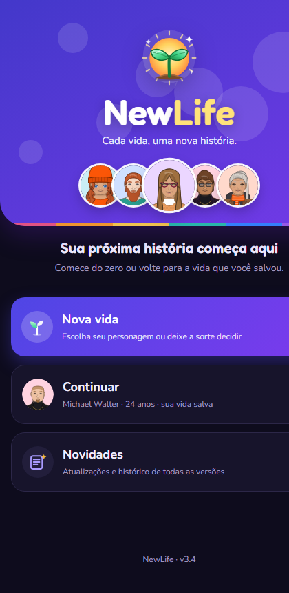
  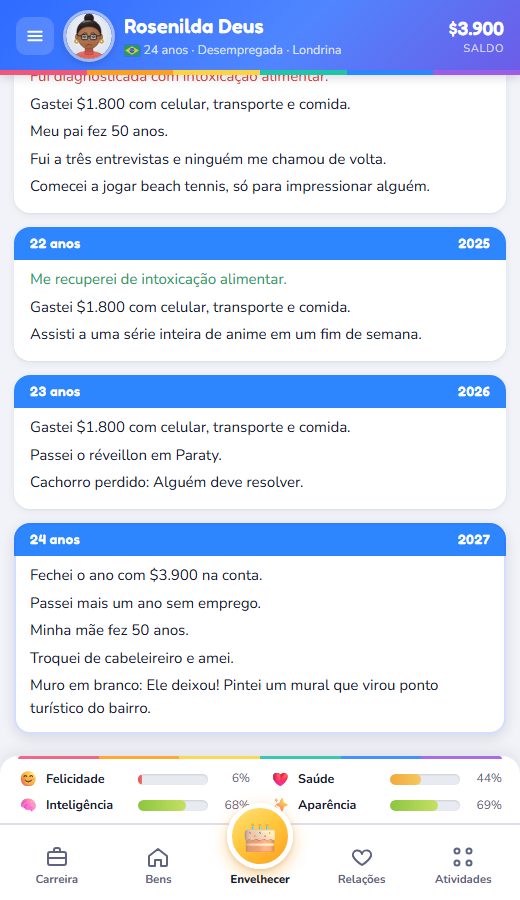
  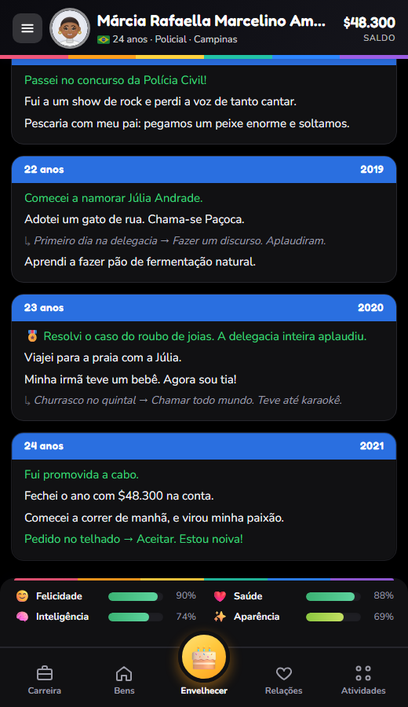
</p>

---

## Sumário

- [O que tem no jogo](#o-que-tem-no-jogo)
- [Modos fictícios](#modos-fictícios)
- [Galeria](#galeria)
- [Como jogar](#como-jogar)
- [Como compilar](#como-compilar)
- [Testes automáticos](#testes-automáticos)
- [Estrutura do projeto](#estrutura-do-projeto)
- [Créditos dos dados](#créditos-dos-dados)

---

## O que tem no jogo

Cada ano é um sorteio: o diário conta o que aconteceu e você decide o que fazer nos eventos. Tudo é aleatório o bastante para duas vidas nunca serem iguais.

### 👶 Nascimento e genética
- **Tela inicial** com Nova vida, Continuar e Novidades; escolha uma vida personalizada ou aleatória.
- Pais com aparência coerente com o país (tom de pele, cabelo e olhos); **filhos herdam** traços, altura, inteligência e talentos dos pais.
- **15 países**, cada um com banco próprio de nomes e sobrenomes (mais de 2.400 só no Brasil), sem repetir nomes entre vidas.

### 🎨 Personagens desenhados
- Rostos em vetor com sombreado suave, montados por peças: **21 cabelos**, barbas, óculos de grau e **7 modelos de óculos de sol**, chapéus, brincos, piercings e maquiagem, separados por gênero e trocáveis no menu Visual.
- **Proporções por idade**: bebê, criança pequena, criança, adolescente, adulto e idoso são visualmente diferentes. Rugas, linhas de expressão e cabelo grisalho aparecem aos poucos; parte dos homens fica calva.
- **Homens e mulheres com traços próprios**: mandíbula quadrada, sobrancelhas grossas, ombros largos e barba por fazer neles; rosto mais fino, cílios, sobrancelhas arqueadas, nariz menor e lábios marcados nelas.
- **Doenças aparecem no rosto**: catapora deixa pintas (e marquinhas para sempre), quimioterapia deixa careca, vitiligo, conjuntivite, catarata, acne…

### 🏫 Escola e faculdade
- **Semana de provas todo ano**, da escola à pós, com perguntas de múltipla escolha. Quem estudou no ano descarta alternativas erradas, e errar pesa pouco.
- **As perguntas seguem a dificuldade do jogo**: no Fácil aparecem 2 alternativas e perguntas mais simples; no Normal, 3; no Difícil, todas.
- **Recuperação** quando a média cai e **vestibular** com 5 questões que somam pontos para a faculdade.
- Minigames da escola: simulado, tabuada, redação, feira de ciências, trabalho em grupo e recreio.
- Faculdade com seminário, **estágio** (bolsa e vantagem no primeiro emprego da área), iniciação científica e **TCC** com orientador e defesa.
- Faculdade **pública** (nota de corte) ou **particular** (família paga, bolsas ou financiamento), cursos técnicos e pós-graduação.
- Quem quer avançar rápido liga **Minigames da rotina** em Configurações: provas, vestibular e entrevistas se resolvem sozinhos pelo nível do personagem.

### 💼 Trabalho e dinheiro
- **Mais de 130 profissões**, cada uma com um **minigame de situações** e um **desafio de raciocínio** da área (troco, diagnóstico, caça ao erro no código, triagem, receita certa…).
- **Entrevista de promoção**, **experiência na área** (entra em cargo mais alto ao trocar de emprego), **especializações**, **certificações**, avaliação anual com negociação de aumento e **freelas**.
- **Advertências e RH**: três dias ruins levam a uma conversa que pode terminar em demissão. Reputação alta atrai propostas de outras empresas.
- **Carreira de lutador**, da rinha clandestina ao cinturão mundial, em MMA, boxe, muay thai, kickboxing ou jiu-jítsu.
- **Contas fixas por ano** conforme a economia e a inflação do país: IPTU e manutenção da casa, imposto, revisão e combustível do carro. O carro se desgasta e quebra. Plano de saúde, seguro, doações, festas e fim de semana de luxo.
- Antes dos 18, a tela de Bens mostra o **dinheiro da família**.

### ❤️ Relações
- Barras de **amor** e **amizade** para cada pessoa, e **gostos** próprios: acertar o assunto na conversa ou o programa do encontro aproxima muito mais.
- **DR** quando o relacionamento esfria, **festas com dança** (aniversário infantil, festa da turma e festa adulta) e **saídas para beber** na idade legal de cada país, com a volta para casa: aplicativo, carona, a pé ou dirigindo, com blitz e acidentes.
- Namoro, casamento, filhos, divórcio, amigos e pets. Gravidez na adolescência a partir dos 16, com alguém da mesma faixa de idade, e consequências na escola e na família.
- **Brincadeiras de criança** (esconde-esconde, pega-pega, desenho, videogame) e pedidos aos pais.

### 💞 Namoros e casamentos plurais
- Em **Amor → Relação com mais pessoas**, ou na ficha de um parceiro adulto, proponha incluir mais uma pessoa.
- Cada parceiro responde conforme abertura, ciúme e vínculo. **Todos precisam aceitar**, e a pessoa nova também pode recusar.
- Cada rodada libera uma inclusão. Com dois parceiros, os dois precisam aceitar antes de incluir o terceiro, e assim por diante.
- Uma recusa impede a inclusão; só é possível retomar a conversa no próximo ano. Acordos e respostas ficam salvos.
- Relacionamentos consentidos podem virar noivados e casamentos, sem punição automática de traição. Casos secretos continuam separados desses acordos.

### 🥋 Lutas e brigas
- **Luta tática**: cada golpe tem um tipo e o adversário dá sinais do que vai fazer. Fôlego, luta no chão, finalização e adversários que antecipam os seus golpes.
- **Proficiência em luta**: treino, faixas e profissão somam. Um lutador profissional desarmado vence uma pessoa comum quase sempre.
- **9 artes marciais** com faixas e um golpe especial na última.
- **Armas brancas e de fogo** com a lei de cada país (compra fácil, licença com exame ou mercado negro) e abordagens policiais para quem anda armado onde é proibido.

### 🚔 Crime e prisão
- Crimes avulsos com minijogos, **facção** do olheiro ao dono do morro e **assassino de aluguel**.
- **Serviços ilegais**: contratar um matador, o cartel ou uma quadrilha para um assalto, e comprar diploma falso. Paga-se adiantado, e traição, chantagem e delação fazem parte do pacote.
- **Drogas** com a lei de cada país (legal, descriminalizada, crime ou crime grave), vício, overdose e reabilitação. **Doping** no esporte.
- Prisão com rotina, grupo, motim, brigas e **fuga em minijogo de labirinto**.

### 🚓 Polícia e investigação
- **Concurso para a polícia** (18 a 40 anos, ensino médio, ficha limpa) e carreira de policial a delegado.
- Mais de 200 eventos de patrulha, investigação e delegacia.
- **Investigue crimes** num minijogo de dedução: assassinato na mansão, roubo de joias, envenenamento, sequestro… Interrogue suspeitos, reviste casas, chame a perícia, cheque câmeras e acuse. Acertar dá promoção; errar põe um inocente na cadeia.

### 🛐 Seita ou grupo religioso
- **Funde o seu grupo começando na deep web**: escolha o fórum, acerte o tom do post, junte seguidores online e marque encontros secretos.
- Seis estágios (Fórum, Célula, Comunidade, Igreja, Movimento, Império da fé) com **doutrinas**, **sermão ao vivo** em minigame, segurança, **atentados**, rivais e o risco de uma revolta.
- **Ou entre num grupo** (inclusive um secreto, com iniciação), suba de cargo, proteja o líder num atentado, dispute a sucessão ou conspire para derrubá-lo.
- **Sucessão escolhida na fundação**: hereditária (o filho com quem você continua a vida herda o grupo), escolhida por você ou por um conselho de anciãos.
- **Hereges** com **debate ao vivo** em minigame e risco de **cisma**, que cria uma seita rival com parte dos fiéis. **Caça ao traidor** com três suspeitos e uma pista de cada. **Guerra santa** contra a seita rival.
- **Fé no mundo**: do estágio Movimento em diante, abra missões país por país (cada cultura pede uma abordagem), construa catedrais e tome governos por eleição, golpe, revolução ou acordo. O mundo reage com sanções, banimentos e cruzadas, e quem conquista os 15 países vira **Rei do Mundo**.

### 🏛️ Política e guerra
- **Política de cada país**: presidencialismo ou parlamentarismo, cargos com nomes locais e partidos próprios (no Brasil, com alusão aos mais conhecidos).
- **Campanha** com bandeira, debate na TV, reta final e segundo turno. Senado, coalizão, projetos de lei, orçamento e crises, com efeito real na economia do país.
- **Escândalos**: propina, acordo com facções, lavagem de dinheiro, operação policial, CPI e impeachment. Escândalos econômicos para governadores e presidentes.
- **Guerras**: relações entre países, alianças militares, guerra local ou mundial, territórios conquistados e perdidos, capital cercada, exílio, prisão ou morte pelo inimigo. O cidadão comum vive convocação, frente de batalha, bombardeios e racionamento; o militar pode ir à frente ou espionar outro país.
- **Domínio mundial** para presidente, ditador ou monarca: influência, governo fantoche, plebiscito e invasão em cada país, com títulos de Potência regional a **Rei do Mundo**. Proclame um **império hereditário** (o filho herda trono e império) ou uma federação.
- **Coalizões**: quanto mais poder, mais países se unem contra você, com sanções, ultimato, ameaça nuclear e guerra de coalizão. Os países dominados se revoltam, e o governo do mundo tem as próprias crises.

### ✊ Derrubar o governo
- Movimento clandestino com apoio do povo, armas, generais subornados e a polícia política no seu encalço.
- **Golpe de Estado** em etapas (primeiro alvo, o que fazer com o presidente, os quartéis): se der certo, você vira líder supremo; se der errado, é prisão, exílio ou fuzilamento.
- **Depois do golpe**, escolha que país construir (ditadura militar, monarquia hereditária, revolução, teocracia ou transição democrática), com medo, lealdade dos militares, pressão internacional, salário próprio e investigações.
- **Anexe territórios** escolhendo o país: cada um tem força militar, e o programa nuclear pesa na conta.

### 👻 Paranormal
- Investigue cemitérios, castelos, florestas na lua cheia e hospitais abandonados, junte provas e lance um documentário (ou vire meme).
- **Vampiros e lobisomens** podem matar você, ou morder. Aí é para sempre, na vida normal: o rosto muda, a sede de sangue ou a lua cheia aparecem todo ano, a família corre perigo e caçadores batem na porta. Existe uma cura, cara e difícil.
- Mais de 200 eventos de caça-fantasmas, vida de vampiro e vida de lobisomem.

### 🔦 Investigação paranormal profissional
- Em **Carreira → Investigador paranormal** ou **Atividades → Investigar o paranormal**, abra a agenda a partir dos 18 anos.
- Clientes procuram investigações e expulsões. Contratos anuais têm risco, recompensa e reputação; a confiança dos clientes aumenta a quantidade de pedidos.
- Explore quatro cômodos e volte à van. Use seis equipamentos para reunir três evidências, consulte o bestiário e identifique uma das oito entidades.
- Sanidade e bateria acabam; caçadas exigem esconderijo ou fuga. Prepare proteção e escolha o ritual correto para os pedidos de expulsão.
- Relatório correto paga e aumenta fama. Expulsão pendente paga apenas 40%; erro ou abandono não paga. Ao envelhecer, contratos em andamento são abandonados.
- O caso em andamento e o bestiário ficam salvos com a vida. Equipamentos têm três melhorias de autonomia.
- Vampiros e lobisomens podem desenvolver **quatro doenças exclusivas**, tratadas na clínica sobrenatural em Saúde.
- **Menu → Novidades** mostra os changelogs completos de todas as versões, com os textos originais dos lançamentos desde a 1.0.

### 📖 Histórias em cadeia
- 800 eventos em sequência, em 160 histórias da infância à velhice: cada escolha decide o próximo capítulo e quando ele chega, às vezes anos depois.
- Quem aparece numa história pode virar amigo, namorado, inimigo ou família de verdade, e uma história pode abrir outra.

### 💔 Traição e divórcio
- Noite fora (boate, bar, boate adulta para maiores de 18), casos secretos que podem ser descobertos e um par que também pode trair.
- Divórcio com filhos menores vai para a justiça: guarda, guarda compartilhada e pensão até os 18 anos.

### 🩺 Saúde
- A maioria das doenças aparece primeiro como sintoma; só a consulta revela o nome. Quanto mais barato o atendimento, mais erra.
- **Expectativa de vida realista**: o corpo se recupera para uma saúde típica da idade e tratar uma doença grave segura o avanço dela. Quem se cuida vive, em média, uns 76 anos, e as causas de morte são coerentes com a história.
- Caxumba sem tratamento pode deixar infértil.

### 🧛 A fera no sangue
- Vampiros têm barra de sede e lobisomens, de fome. Em 100%, a criatura toma o controle e pode atacar estranhos ou a própria família.
- A maldição passa para os filhos, e a criatura briga diferente (mordida, garras, uivo).

### 👥 Membros das equipes
- Clube ou time da escola, colegas de trabalho, banda, elenco, pelotão, equipe de heróis e o grupo religioso têm **gente de verdade**: veja quem está na equipe, converse e faça amizade.
- A **equipe do trabalho** (chefe e colegas) fica no emprego, em "Membros da equipe".
- **Eventos com os membros**: o passe decisivo do colega de time, a dupla do trabalho da escola, o professor exigente, o colega que rouba sua ideia, o chefe em crise, o herói da equipe que é traidor, o fiel que perde a fé, o assessor corrupto, o funcionário do mês, a intriga na corte e os moradores da base e da vila. São quase 400 eventos com membros. Eles viram amigos, namorados, inimigos, vão embora ou entram para o seu grupo, inclusive os colonos de Marte, os náufragos da ilha e o grupo do apocalipse e do isekai.
- **Membros aleatórios em tudo**: equipe do gabinete (ou ministros e generais, se você der um golpe), funcionários da sua empresa, a corte da realeza, os heróis da sua equipe (cada um com codinome e poder) e, nos mundos paralelos, os moradores da base no apocalipse zumbi, da sua vila e da cidade no isekai. Dá para conversar e recrutar.
- A **turma da escola** fica na própria escola, em "Membros da turma", junto com os professores de cada matéria.
- **Passar um tempo com todos**: um churrasco, um almoço de domingo ou um fim de semana com a família e os amigos de uma vez.

<p align="center">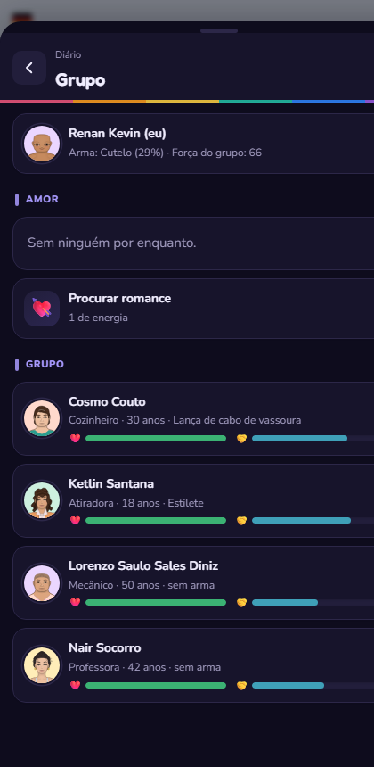</p>

### 🏳️ Desistir dói
- Antes de desistir de uma vida, você vê como cada pessoa próxima vai receber a notícia, de acordo com o quanto ela te ama.

<p align="center">
  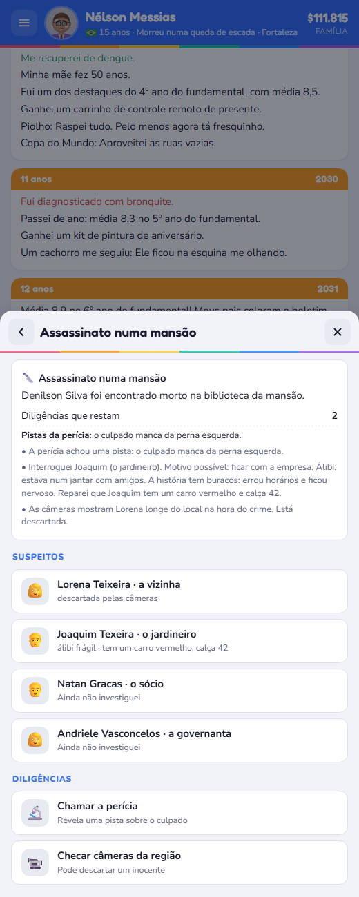
  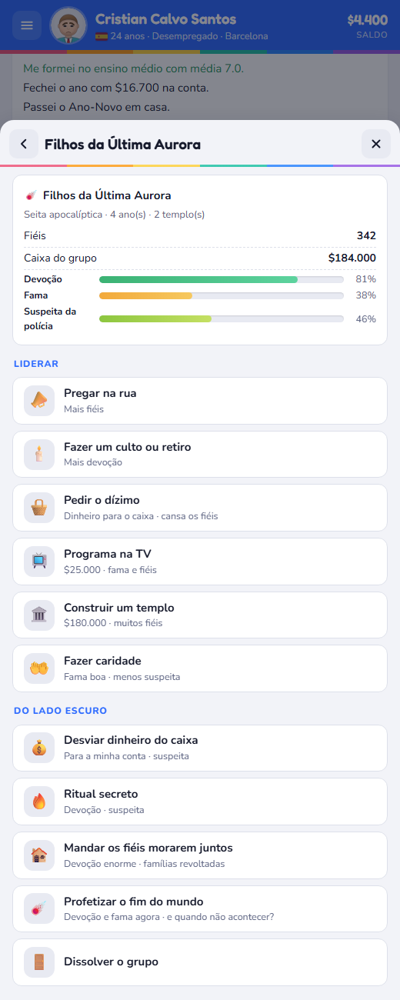
  
  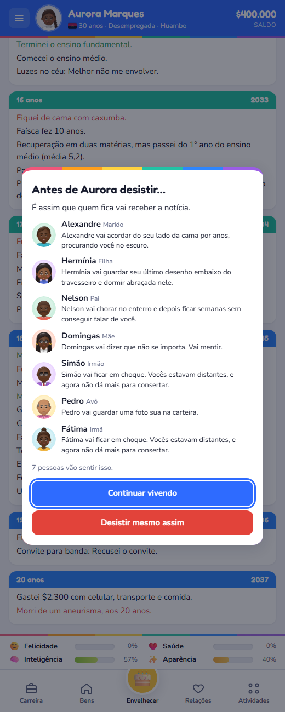
</p>

### 🌅 Vida adulta e velhice
- Férias, contas do mês, encontros com os amigos, **hobbies com níveis** até mestre e crise de meia-idade.
- **Lista de desejos** na velhice, netos (histórias, mesada, receita), memórias que viram livro e baile da terceira idade.

### 🌍 E mais
- **15 países** com eventos culturais próprios (Réveillon, Dia dos Mortos, Diwali, Tomatina, Chuseok…), economia, leis e política diferentes.
- **Copa do Mundo e Olimpíadas** com convocação, jogos e repercussão no mundo inteiro.
- **Idade coerente**: cada tema tem idade mínima (bebida conforme a lei do país, namoro, trabalho, direção, dinheiro), e bebês só veem eventos de bebê.
- **Autoescola**, passaporte (inclusive falsificado) e emigração. **Mais de 80 doenças**.
- **Mais de 5.600 eventos**, conquistas, selos, cemitério, desafios, dificuldade e herdeiros (continue a vida com um filho).
- **Sons e música** sintetizados, tema claro e escuro.
- **Português ou inglês** (Menu → Idioma). Em inglês, telas e botões já estão traduzidos; os eventos ainda estão sendo traduzidos.

## Modos fictícios

A partir dos 18 anos (Menu → Modos fictícios), você pode viver uma aventura contada **em dias**, fora da vida normal. Enquanto ela dura, você não envelhece e carreira, bens e relações aparecem com cadeado, mas **a vida real não para**: na volta pode ter demissão por abandono, notas baixas, matrícula cancelada, fim de namoro (ou divórcio por abandono do lar), contas atrasadas e a família desesperada. Quanto mais tempo longe, pior: depois de meses ou anos você pode ser declarado morto e encontrar seu amor com outra pessoa. A tela vira a da aventura: **Local**, **Itens**, **Próximo dia**, **Grupo** e **Ações**.

- **3 de energia por dia**: cada ação e cada lugar só pode ser feito uma vez por dia.
- **Grupo** com nome, rosto, arma, saúde e lealdade; **itens** como cartas com estado de 0 a 100% (comida estraga, armas quebram).
- **A aventura chega aos poucos**: escolher um modo não te joga lá dentro. No zumbi, primeiro vêm as notícias, no ano seguinte as prateleiras vazias e só no terceiro ano o fim do mundo (dá para estocar, comprar arma, treinar e fugir com a família). Ilha e Marte começam com um convite: ir sozinho, levar o par, os filhos ou a família toda, ou recusar. Isekai começa com sonhos, e Superpoderes com um acidente estranho. Quem vai junto vive tudo com você e volta para casa, ou morre lá.
- **Começos sorteados**: 28 histórias de início (o plantão no hospital, o cruzeiro que afundou, invocado pelos magos, a herança da avó heroína, clandestino na nave…), cada uma com itens, grupo, veículos e vantagens diferentes. O herói tem 18 poderes possíveis.
- **Comerciantes** aparecem em alguns dias com até 4 itens à venda; cada mundo tem sua moeda (ouro, sucata, dinheiro, dados de pesquisa ou troca por comida).
- **Eventos de escolha** próprios de cada modo, com consequências de verdade.
- **Romance em todos os modos**: flertar, encontros com a cara de cada mundo, namoro, noivado, casamento e filhos. Se a aventura terminar bem, o par e os filhos voltam com você para a vida real.
- **Não existe acordar**: se morrer num mundo alternativo, morre de verdade. Antes de ir, uma janela explica para onde você vai e como volta (resgate, portal, nave… ou nunca, no apocalipse zumbi). Venceu? Volta com recompensas. **O modo Superpoderes é diferente**: passa ano a ano, junto com a vida real, e só acaba quando você se aposenta.

| Modo | Resumo | Eventos |
|---|---|:-:|
| 🧟 **Pesadelo zumbi** | O apocalipse **não tem fim**: é sobreviver até morrer e bater o seu recorde de dias. Comboio de carros ou base fixa, facções, oficina, estações do ano e hordas cada vez maiores. | 570+ |
| 🏝️ **Ilha deserta** | Explore praia, selva, cachoeira, caverna e os destroços do avião. Fome, sede, abrigo, fogueira, SOS e uma jangada. | 200+ |
| ⚔️ **Isekai** | Você acorda numa das 4 cidades de Eldoria (sorteada). Classe, níveis, atributos, grimório com 16 magias, masmorras, companheiros e o Rei Demônio. Dá para morar numa cidade ou **fundar sua vila**. | 980+ |
| 🦸 **Superpoderes** | A vida segue **por ano** e não tem fim, só a aposentadoria. Equipes de heróis que contam como emprego, Lei de Registro, identidade secreta, família na mira dos vilões e arqui-inimigos que nunca acabam. | 290+ |
| 🚀 **Colônia em Marte** | Oxigênio, comida e sanidade da equipe, rover, pesquisa e expedições até a nave de resgate no sol 30. | 200+ |

### 🧟 Pesadelo zumbi em detalhe

- **Sem final**: não existe resgate. Cada dia vivido conta, e o jogo guarda o seu **recorde**. Com o tempo, as hordas ficam maiores e os zumbis mais perigosos.
- **Ficha do sobrevivente**: Força, Pontaria, Furtividade, Medicina, Mecânica e Liderança, com pontos a cada nível.
- **Atividades de apocalipse**: procurar comida, água, remédios, combustível, armas e materiais; expedições a supermercados, farmácias, quartéis e ferro-velhos; caçar, pescar, filtrar água, patrulhar, montar armadilhas, apagar rastros, tratar feridos e pesquisar a cura.
- **Saúde, sanidade, fome e sede**, **munição** para armas de fogo e **barulho**: tiros, gerador e fogueiras atraem hordas.
- **Estações do ano**: verão (sede), outono, inverno (frio sem roupas de frio machuca) e primavera (horta rende mais).
- **Base**: você escolhe o lugar e o nome. Tem 14 construções (muros, torre de vigia, armadilhas, horta, poço, cozinha, alojamentos, depósito, enfermaria, oficina, garagem, rádio, gerador e laboratório), moradores que comem e bebem do estoque, moral, regras de ração e de quem entra.
- **Oficina**: 16 receitas com sucata (taco com pregos, besta, coquetel molotov, armadura de pneu, recarga de munição, silenciador, vacina caseira…).
- **4 facções** com reputação: Mercadores do Viaduto, Os Corvos, Guarda Nacional e Igreja da Última Hora. Dá para trocar, fazer missões, pedir ajuda, roubar o acampamento, atacar ou firmar aliança.
- **A grande horda** chega a cada 16 a 24 dias e é cada vez maior.

<p align="center">
  
  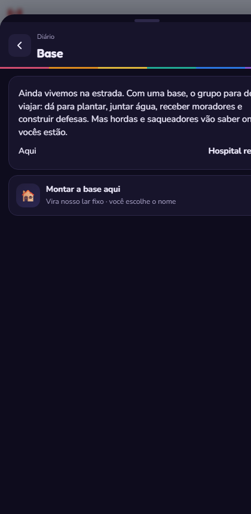
  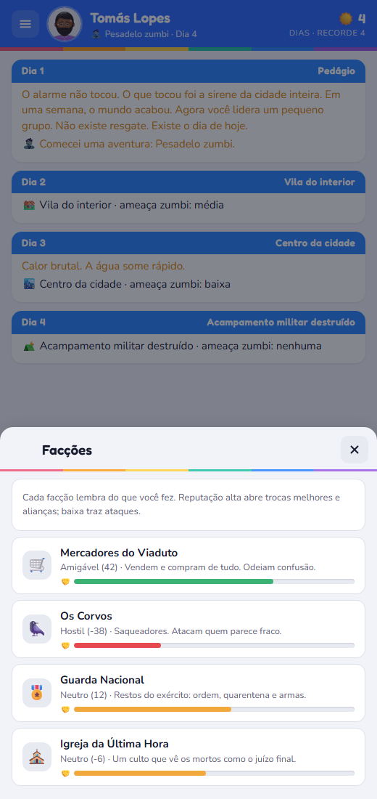
  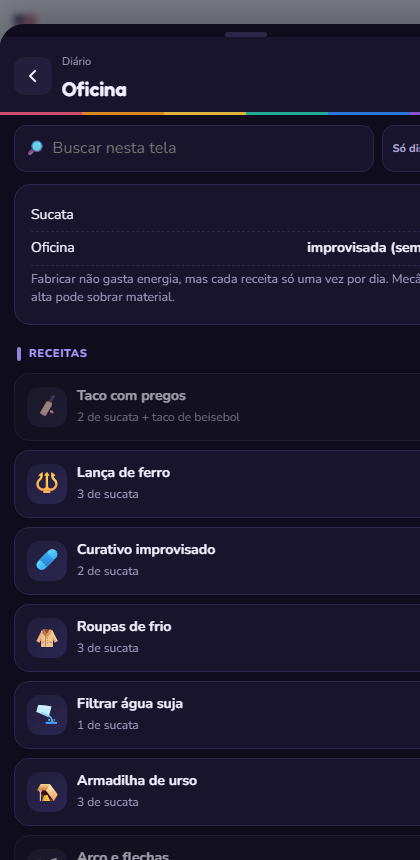
</p>

### 🦸 Superpoderes em detalhe

- **Por ano, sem fim**: cada turno é um ano da vida real. Você e a família envelhecem, a família ganha e gasta dinheiro, gente nasce e morre. O modo só acaba quando você **pendura a capa** e volta para a vida normal (ou quando morre de verdade).
- **Equipes de heróis são emprego**: Novatos Unidos, Sentinelas do Sul, Vértice Corp, Agência Federal de Contenção e Liga Guardiã. Cada uma tem salário anual, cargos de recruta a líder, desempenho, promoção, aumento e demissão.
- **Lei de Registro**: o governo exige nome, endereço e DNA de todo herói. Dá para se registrar, registrar um nome falso ou se recusar, e **recusar é crime**: a polícia passa a caçar você, e ser pego dá anos na Prisão de Contenção para Super-Humanos. Cada equipe toma um lado.
- **Identidade secreta**: se ela vazar, o mundo inteiro sabe quem você é, e **os vilões passam a atacar sua família** (sequestros, invasões, bombas). Familiares podem se ferir ou morrer de verdade. Dá para esconder a família, contar o segredo a quem você ama, negar tudo na TV ou fingir a própria morte.
- **Amor da vida real**: namorar, noivar, casar e ter filhos sem largar a capa, com eventos de encontros interrompidos, ciúme e desconfiança.
- **Arqui-inimigos sem fim**: derrote um três vezes e outro aparece nos jornais.

<p align="center">
  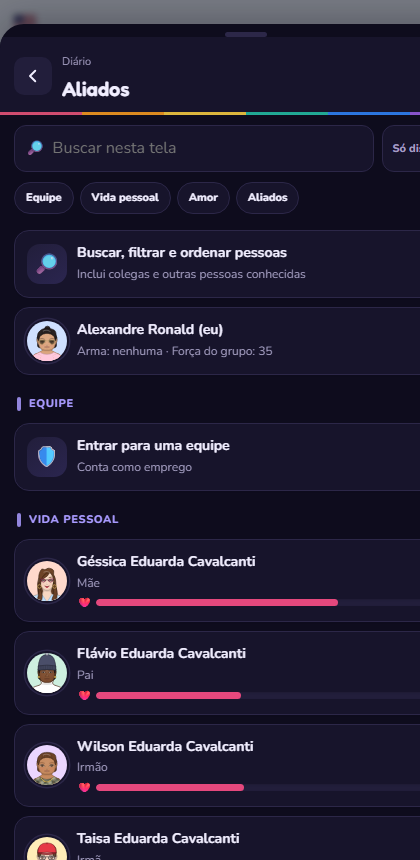
  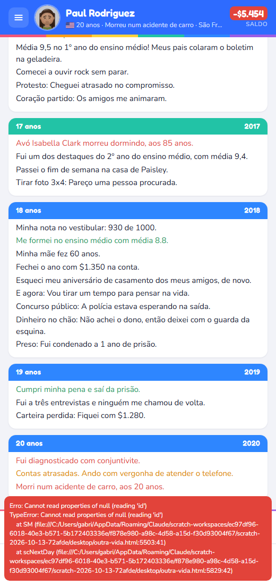
  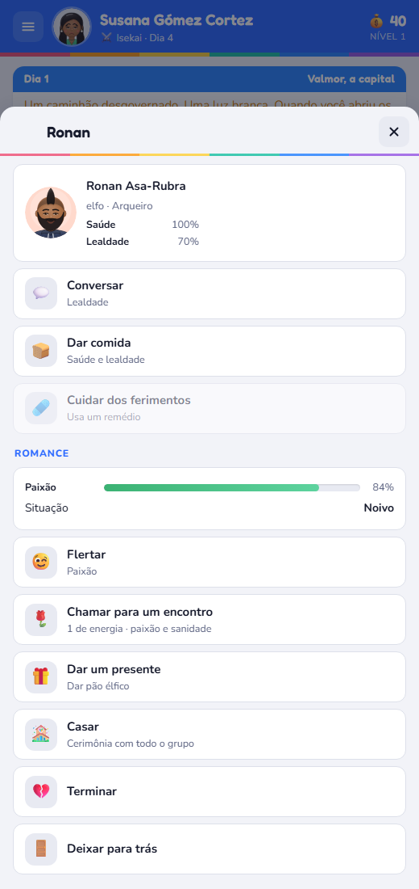
</p>

### ⚔️ Isekai em detalhe

- **Ficha do herói**: Força, Magia, Agilidade e Vitalidade, com pontos para distribuir a cada nível e habilidades de classe nos níveis 5, 10 e 15.
- **Grimório**: Bola de Fogo, Cura, Escudo Arcano, Teleporte, Ressurreição e outras. Gastam mana, sobem de rank com o uso e são aprendidas por nível, na Academia arcana e na Torre de magia.
- **4 cidades**, cada uma com mais de 100 eventos próprios: **Vila de Aurora** (vida no campo), **Valmor** (a capital: corte, nobres e intriga), **Ferro Fundo** (cidade dos anões) e **Aerion** (cidade flutuante dos magos). Dá para trabalhar, ganhar reputação, comprar casa e se mudar.
- **Sua própria vila**, com mais de 400 eventos, que cresce de **Acampamento → Aldeia → Vila → Cidade → Grande cidade**:
  - você escolhe o nome (e pode trocar depois);
  - os moradores consomem **comida, roupas e mantimentos** todo dia;
  - **16 construções** com níveis (casas, fazenda, tecelagem, serraria, mercado, escola, muralha, hospital, torre de magia, universidade…);
  - **16 tecnologias** (agricultura, escrita, medicina, engenharia, imprensa, máquina a vapor…);
  - **leis**: impostos, ração por morador, entrada de novos moradores (aberta, com seleção ou fechada) e se moradores podem entrar no seu grupo.

<p align="center">
  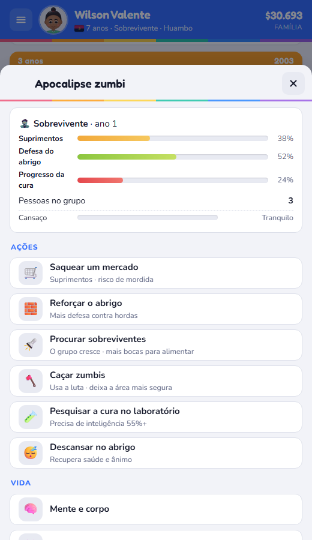
  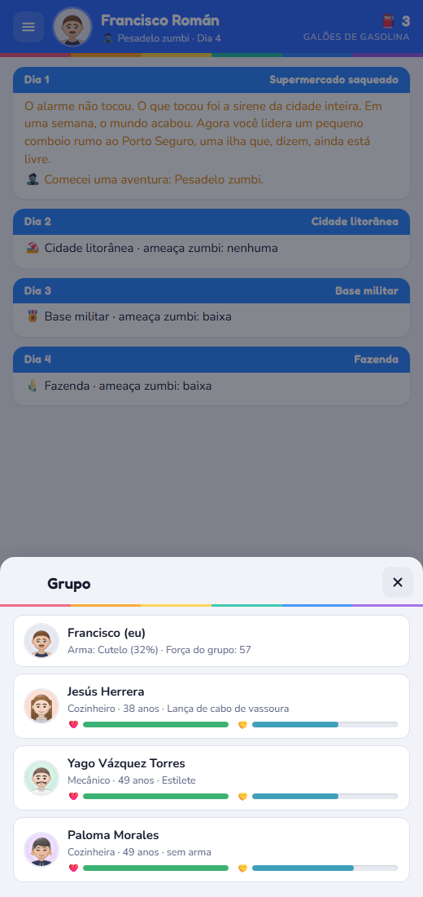
  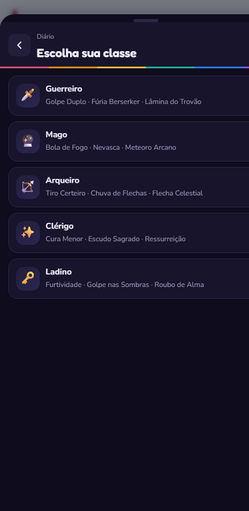
  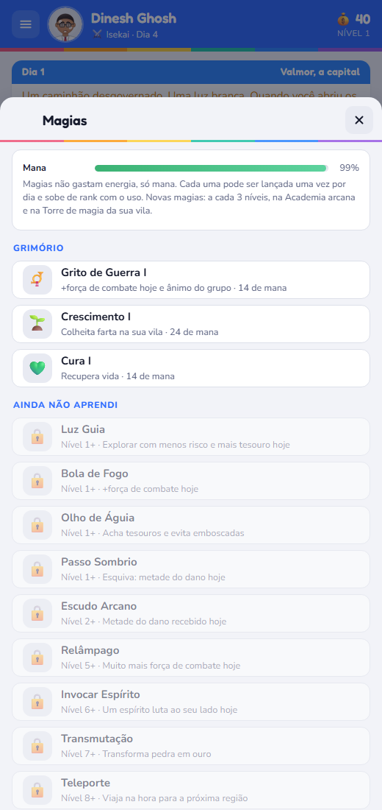
</p>
<p align="center">
  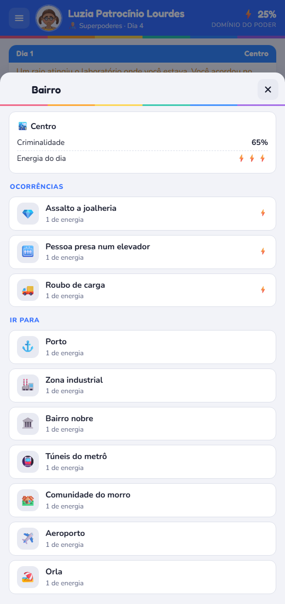
  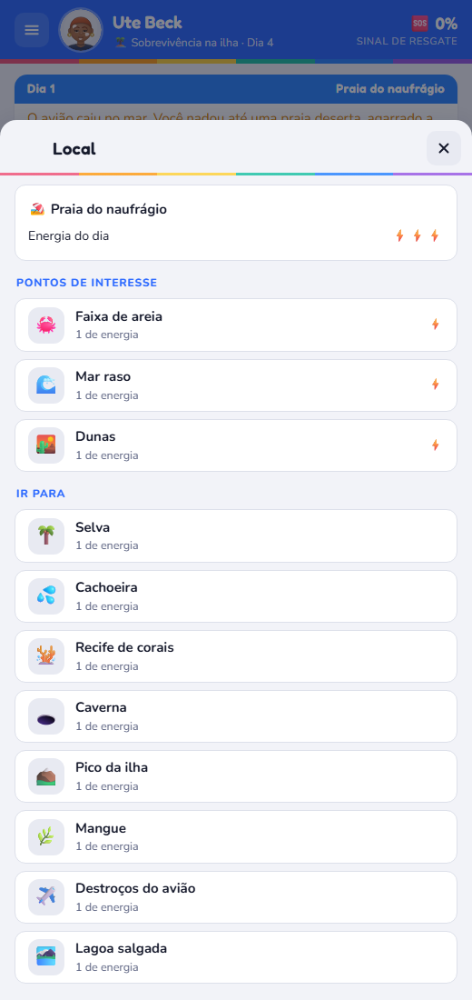
</p>

## Galeria

| | | |
|:-:|:-:|:-:|
| 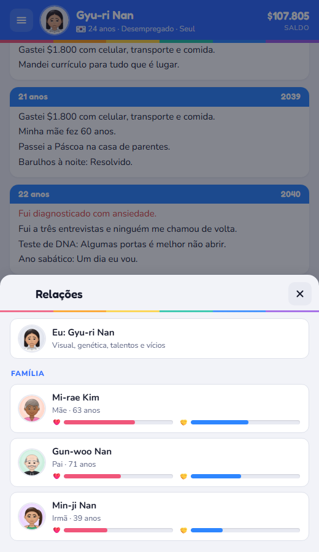<br>Relações | 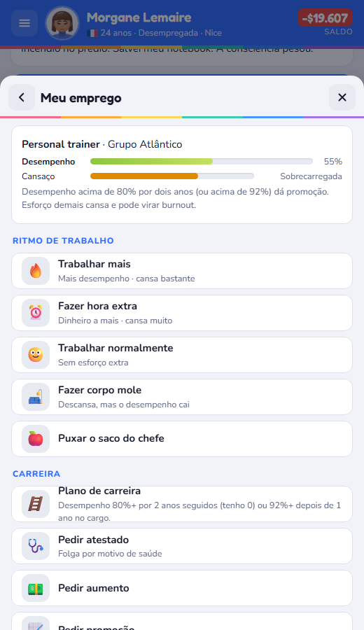<br>Emprego | 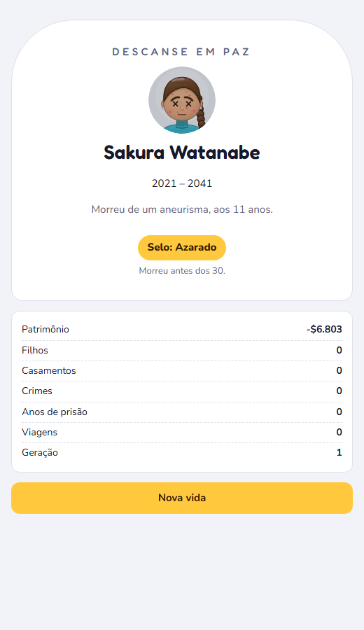<br>Prova |
| <br>Faculdade | 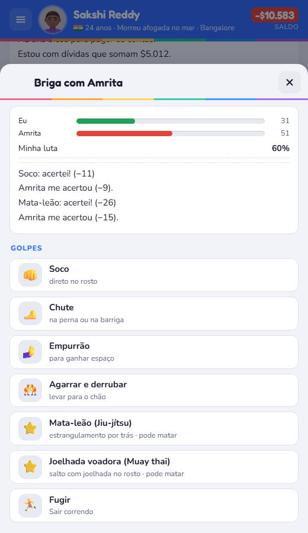<br>Briga | 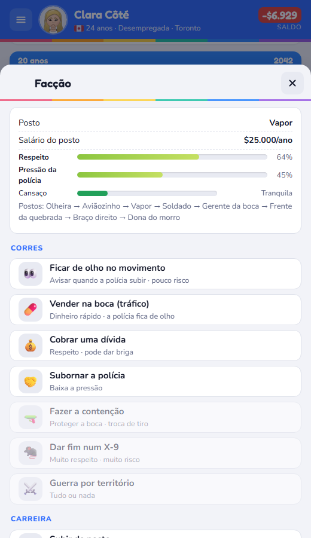<br>Facção |
| 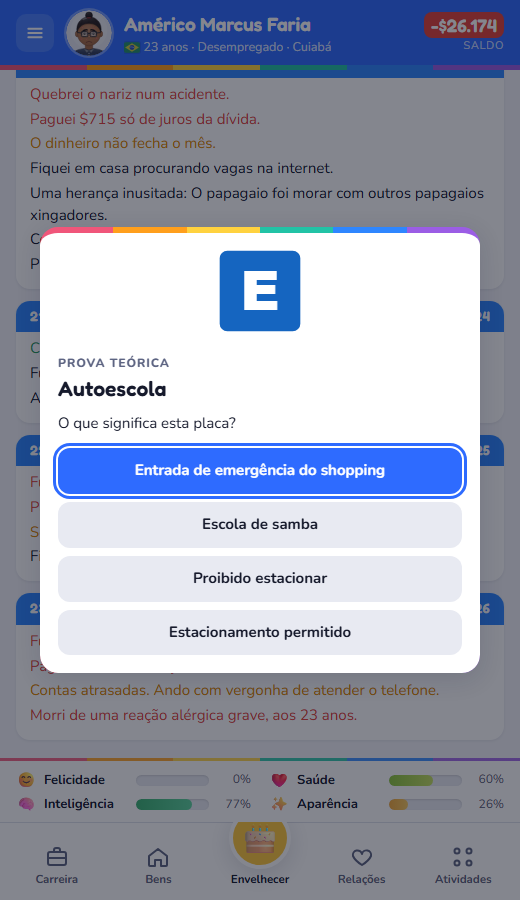<br>Autoescola | 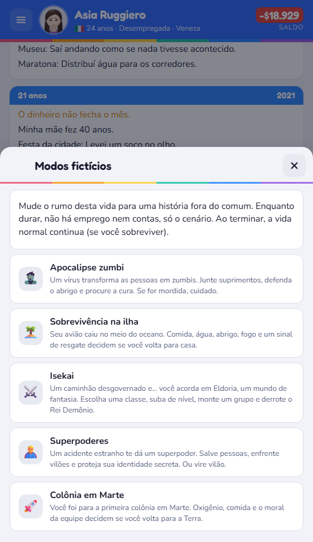<br>Modos fictícios | <br>Pesadelo zumbi |

<p align="center">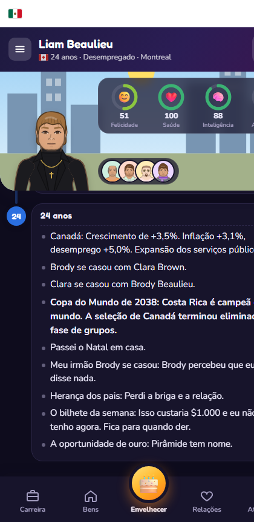</p>

## Como jogar

Baixe a versão mais recente na aba **[Releases](../../releases)**:

- **Windows**: `NewLife.exe`. É só abrir; o progresso fica salvo em `%LOCALAPPDATA%\OutraVida\saves`.
- **Android** (5.0 ou mais novo): `NewLife.apk`. Passe para o celular e abra; o Android vai pedir para permitir instalação de fontes desconhecidas.
- **Navegador**: [madeiragab.github.io/newlife](https://madeiragab.github.io/newlife/). O progresso fica salvo no próprio navegador.

Toque em **Envelhecer** para passar um ano. Use **Carreira**, **Bens**, **Relações** e **Atividades** para viver a vida.


### 🔄 Atualização automática
Os apps de **Android** e **Windows** procuram uma versão nova sempre que abrem. Se existir, baixam o jogo novo e recarregam sozinhos, sem reinstalar e sem perder o progresso. Sem internet, abrem a última versão que tiverem. A versão atual aparece no fim do menu, enquanto baixa aparece um anel de progresso com a música do jogo, e depois de cada atualização um quadro mostra as novidades (uma vez só). O histórico fica em Menu → Novidades.

## Como compilar

Tudo é feito por scripts PowerShell no Windows.

| Comando | O que faz | Precisa de |
|---|---|---|
| `.\build.ps1` | Junta `src/` em `outra-vida.html` (navegador) e `desktop/outra-vida.html` (app) | Nada |
| `.\make-exe.ps1` | Gera o ícone e compila `NewLife.exe` com pywebview + PyInstaller | Python 3 (o script cria um ambiente virtual sozinho) e Microsoft Edge |
| `.\make-apk.ps1` | Compila `NewLife.apk` sem Gradle (aapt2, javac, d8, zipalign, apksigner) | Android SDK em `%LOCALAPPDATA%\Android\Sdk` (`platforms;android-34` e `build-tools;34.0.0`) e JDK 17 |
| `.\publish-web.ps1` | Atualiza a versão do navegador (branch `gh-pages`) | Git com acesso ao repositório |

> Na primeira compilação do APK, o script cria uma chave de assinatura em `android/newlife.keystore`. **Guarde essa chave**: sem ela não dá para atualizar o app por cima. Ela está no `.gitignore` e nunca deve ir para o repositório.

Rode `make-exe.ps1` antes do `make-apk.ps1`, porque ele gera o ícone usado pelo APK.

A versão **Roblox** fica em [`roblox/`](roblox/README.md). Ela é gerada a partir do mesmo `src/` e publicada sozinha pelo GitHub Actions a cada push na `main`.

## Testes automáticos

[](https://github.com/madeiragab/newlife/actions/workflows/testes.yml)

`test.ps1` usa Node 22+ e Edge sem janela, com semente reproduzível, progresso e relatórios em `test-results/`. A simulação inclui regressões familiares, judiciais, econômicas e um save sintético produzido na versão 1.46 (empresa, casa financiada e carro). O modo de teste mantém snapshots em memória para verificar a máquina do tempo, mas não grava saves no navegador.

O Actions executa os testes antes de publicar no GitHub Pages. O job de publicação depende da aprovação e recebe exatamente o HTML testado. `publish-web.ps1 -ReuseTest` exige um comprovante local que confere os hashes de fontes e artefatos; mudanças durante ou depois do teste invalidam a aprovação. Sem esse parâmetro, o script executa a simulação completa. Fora do CI, o script exige o commit já enviado para `main` e solicita uma execução do workflow pelo `gh`; não publica diretamente pela branch `gh-pages`. Não há liberação por variável de ambiente.

Os relatórios incluem 180 projeções financeiras: quatro estratégias em 15 países e três sementes, dos 30 aos 90 anos, mantendo emprego e sem mortalidade. Também registram rankings operacionais por década e quatro percursos automatizados de vida. Isso ajuda a encontrar estratégias dominantes e regressões, mas não substitui sessões humanas nem demonstra equilíbrio econômico. O cálculo `empresaCalcular()` recebe unidade, conjuntura, preços, comércio e variação explicitamente, sem modificar suas entradas.

| Comando | O que faz |
|---|---|
| `.\test.ps1` | Abre o jogo no Edge sem janela (cerca de 6 minutos) e simula dezenas de vidas inteiras, testando ações, telas, todos os eventos em várias idades, regras da prisão, equilíbrio das brigas e textos com lacunas. |
| `.\quality.ps1` | Relatório de qualidade do texto: concordância de gênero, frases repetidas e eventos que nunca aparecem. |
| `python -I tools/audit_events.py` | Procura eventos cujo texto promete algo que o efeito não faz: nascimento sem bebê, morte sem ninguém morrer, item ganho sem item. |
| `.\aventura.ps1` | Joga cada modo fictício 40 vezes e mostra a taxa de vitória e por que se perde (saúde ou sanidade), para equilibrar a dificuldade. |
| `.\shots.ps1 -Views demo-rostos` | Tira prints de telas de demonstração (`#demo-…`) para conferir o visual. |

## Estrutura do projeto

```
src/            código do jogo (HTML/CSS/JS puro, sem dependências)
  data.js         dados: países, cursos, carreiras, doenças, crimes, itens
  core.js         vida, anos, genética, dinheiro, saúde, escola, trabalho
  events*.js      eventos do ano (formato compacto)
  ev_*.js         pacotes de eventos por tema (DSL em ev_dsl.js)
  faces.js        desenho dos rostos e acessórios
  quiz.js         provas com perguntas
  life.js         sobrecarga, emprego, clubes, bicos, compras de menores
  careers.js      plano de carreira, porte da empresa, demissões raras
  fight.js        artes marciais, brigas por turnos, aulas
  prison.js       vida na prisão
  social.js       relações, autoescola, passaporte, facção, assassino de aluguel
  scen.js         modos fictícios: motor das aventuras (dias, energia, grupo, itens, locais)
  seita.js        seita ou grupo religioso (e os ganchos de eventos da vida normal)
  policia.js      concurso da polícia e investigação de crimes
  golpe.js        movimento clandestino e golpe de Estado
  dominio.js      seita e império mundiais: sucessão, hereges, traidores, guerra santa, coalizões e Rei do Mundo
  paranormal.js   fantasmas, vampiros e lobisomens
  desistir.js     reações de quem fica ao desistir da vida
  seita2.js       seita: cargos, fé dos seguidores, revolta, denúncias e domínio
  equipes.js      membros das equipes (escola, trabalho, heróis, grupo religioso)
  membros.js      membros aleatórios: gabinete, empresa, corte, heróis e moradores dos mundos paralelos
  romance.js      romance nos modos fictícios: namoro, casamento, filhos e volta para a vida real
  heroi.js        superpoderes: equipes como emprego, Lei de Registro, identidade, família e anos
  cursos.js       empregos de cada faculdade e o carro que os pais dão na carteira
  formacao.js     cursos técnicos, especialização, empregos que pedem pós e bônus de salário
  comerciantes.js comerciantes dos modos fictícios
  volta.js        consequências na vida real ao voltar de um modo fictício
  inicios.js      histórias de começo sorteadas e poderes novos
  prologo.js      a aventura chegando aos poucos na vida real (convites, notícias, quem vai junto)
  zumbi.js        pesadelo zumbi: atributos, base, oficina, facções, estações e hordas
  isekai.js       isekai: atributos, magias e cidades para morar
  vila.js         isekai: a sua vila (recursos, construções, tecnologias, leis)
  ev_sc_*.js      eventos de cada modo fictício (ev_z_*.js: base, facções, mundo e vida no apocalipse)
  ev_cid_*.js     eventos das 4 cidades do isekai
  ev_vila*.js     eventos da sua vila, por fase de crescimento
  sound.js        sons e música sintetizados
  ui.js           telas e menus
desktop/        app de Windows (pywebview)
android/        app de Android (WebView nativa)
tools/          geração do banco de nomes e utilitários
docs/img/       imagens deste README
```

## Créditos dos dados

- Nomes e sobrenomes do Brasil: API de Nomes do **IBGE** (Censo 2022).
- Nomes dos outros países: [popular-names-by-country-dataset](https://github.com/sigpwned/popular-names-by-country-dataset) (CC0), complementados à mão.
- Fontes **Fredoka** e **Nunito** (SIL Open Font License), embutidas para funcionar offline.


## Vidas que continuam · 1.61–1.68

Pessoas próximas podem trabalhar, formar famílias, emigrar e tomar iniciativas. Abra a ficha de uma pessoa em Relações para consultar sua trajetória, orçamento e memórias. O desemprego depende do país onde ela vive; ajudar alguém é uma escolha, sem pagamento automático pelo protagonista.

Decisões cotidianas sobre escola, casa, amizades, trabalho e aposentadoria aparecem conforme a situação da partida. O jornal registra consequências já calculadas e permite consultar os indicadores do país. Não há uma história obrigatória nem retorno garantido por ajudar alguém.

Ao continuar como um filho, IDs e pessoas permanecem no mundo. Vínculos do protagonista anterior ficam no arquivo familiar; o herdeiro conserva seu próprio saldo, país e família, além do patrimônio e contratos herdados. Mandatos e penas criminais não são transferidos.

O pipeline verifica saves produzidos nos HTMLs publicados da 1.59 e 1.60, trajetórias de NPCs, três gerações e os percursos comuns, empresariais, familiares e criminosos. As projeções financeiras de 30 a 90 anos são diagnósticos automatizados, sem mortalidade; não equivalem a playtests humanos nem provam o equilíbrio de todas as estratégias.


## Evolução da vida comum · 1.69–1.74

As versões foram publicadas separadamente: 1.69 corrige ajuda familiar, sucessão, parentesco e gestores; 1.70 melhora acontecimentos e recuperação financeira; 1.71 traz formação e empresas de NPCs; 1.72 inclui decisões familiares e memória; 1.73 aprofunda envelhecimento e rotina; 1.74 verifica a integração e a estabilidade.

NPCs precisam concluir cursos para assumir profissões qualificadas. Parceiros e filhos adultos podem propor reformas, viagens, poupança e mudanças de cidade; cada adulto decide por si e os custos são informados. Memórias influenciam confiança por tempo limitado. Aposentadoria, acessibilidade e redes de apoio têm efeitos leves e persistentes.

Testes controlados de quatro estilos usam sementes 17401–17404 para exercitar três sucessões por estilo, além das partidas automatizadas existentes. Não são sessões humanas nem prova de equilíbrio de todas as estratégias.


## Novidades recentes · 1.75–2.14

Da 1.75 à 2.14: Copa e Olimpíadas, seitas que nascem na deep web, luta tática e carreira de lutador, armas e drogas com a lei de cada país, profissões com minigames, escola e faculdade com provas de verdade, infância e relacionamentos, vida adulta e velhice, expectativa de vida realista, política de cada país, escândalos, guerras e o submundo, golpe de Estado em etapas e o regime depois dele, inglês e, na 2.14, seita e império que dominam o mundo, com sucessão hereditária, hereges, traidores e coalizões contra quem cresce demais. A lista completa de cada versão está em **Menu → Novidades** e nas [releases](https://github.com/madeiragab/newlife/releases).
