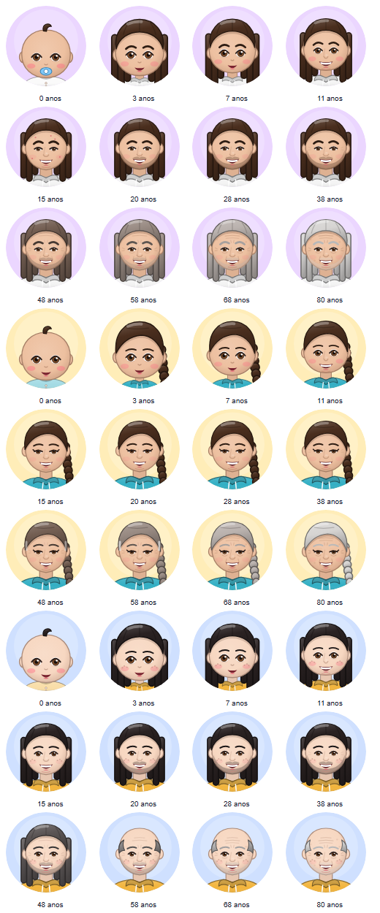

<p align="center">
  
</p>

<h1 align="center">NewLife</h1>

<p align="center">
  <b>Um simulador de vida em português.</b><br>
  Nasça, cresça, estude, trabalhe, ame, erre feio, seja preso, vire herói… e comece de novo.<br>
  Para <b>Windows</b>, <b>Android</b> e navegador, 100% offline depois de instalado.
</p>

<p align="center">
  <a href="https://madeiragab.github.io/newlife/"><b>▶ Jogar no navegador</b></a>
  &nbsp;·&nbsp;
  <a href="https://github.com/madeiragab/newlife/releases/latest"><b>⬇ Baixar para Windows e Android</b></a>
</p>

<p align="center">
  
  
  
</p>

---

## Sumário

- [O que tem no jogo](#o-que-tem-no-jogo)
- [Modos fictícios](#modos-fictícios)
- [Galeria](#galeria)
- [Como jogar](#como-jogar)
- [Como compilar](#como-compilar)
- [Testes automáticos](#testes-automáticos)
- [Estrutura do projeto](#estrutura-do-projeto)
- [Créditos dos dados](#créditos-dos-dados)

---

## O que tem no jogo

Cada ano é um sorteio: o diário conta o que aconteceu e você decide o que fazer nos eventos. Tudo é aleatório o bastante para duas vidas nunca serem iguais.

### 👶 Nascimento e genética
- Primeira vida **totalmente aleatória**; depois você escolhe entre vida aleatória ou personalizada.
- Pais com aparência coerente com o país (tom de pele, cabelo e olhos); **filhos herdam** traços, altura, inteligência e talentos dos pais.
- **15 países**, cada um com banco próprio de nomes e sobrenomes (mais de 2.400 só no Brasil), sem repetir nomes entre vidas.

### 🎨 Personagens desenhados
- Rostos em vetor com sombreado suave, montados por peças: **21 cabelos**, barbas, óculos de grau e **7 modelos de óculos de sol**, chapéus, brincos, piercings e maquiagem, separados por gênero e trocáveis no menu Visual.
- **Proporções por idade**: bebê, criança pequena, criança, adolescente, adulto e idoso são visualmente diferentes. Rugas, linhas de expressão e cabelo grisalho aparecem aos poucos; parte dos homens fica calva.
- **Doenças aparecem no rosto**: catapora deixa pintas (e marquinhas para sempre), quimioterapia deixa careca, vitiligo, conjuntivite, catarata, acne…

### 🏫 Escola e faculdade
- **Provas com perguntas de verdade** (cerca de 140, do fundamental 1 à faculdade) com uma alternativa certa. Antes da prova: ir, faltar ou fingir doença, e os pais podem te obrigar a ir.
- Três faltas no ano ou média baixa = **repetir de ano**.
- **Nota do vestibular** vem do histórico escolar inteiro, desde o 1º ano.
- Faculdade **pública** (nota de corte) ou **particular** (família paga, bolsa por nota, bolsa de atleta, bolsa de música/arte, financiamento ou dinheiro próprio).
- **Clubes e times** com posições (reserva → titular → capitão) que contam para a bolsa.

### 💼 Trabalho e dinheiro
- **Mais de 60 carreiras** com plano de carreira (quem sobe para quem), empresas de portes diferentes e promoções por desempenho.
- Menu do emprego: trabalhar mais, hora extra, corpo mole, puxar o saco do chefe, **atestado** (de verdade ou comprado), aumento e promoção.
- **Eventos raros de demissão**: falência, corte, fusão, substituição por IA, o sobrinho do dono…
- **Bicos** e meio período a partir dos 13. Antes dos 18, para comprar algo você **pede aos pais** (a chance depende do relacionamento) ou usa o próprio dinheiro.
- Gastos anuais, dívidas com juros e **sobrecarga**: fazer coisas demais gera cansaço, depressão, burnout e até a morte.
- 12 carreiras especiais (ator, músico, atleta, streamer…), política, realeza e empresa própria.

### ❤️ Relações
- Barras de **amor** e **amizade** para cada pessoa.
- Quem você conhece nos eventos vira uma pessoa de verdade na sua lista, com nome, rosto e gênero coerentes.
- Namoro, casamento, filhos, divórcio, amigos, pets (cães e gatos por raça, exóticos e animais de fazenda).

### 🥋 Lutas e brigas
- **9 artes marciais** (Judô, Jiu-jítsu, Karatê, Muay thai, Boxe, Taekwondo, Capoeira, Kung fu, Krav maga) com faixas, uma por ano, e um **golpe especial** na última.
- **Briga por turnos**: você escolhe os golpes; alguns podem matar, e às vezes você bate para apagar e mata sem querer.
- Adversários com força por idade; alguns adultos também sabem lutar.

### 🚔 Crime e prisão
- Crimes avulsos com minijogos (assalto a casa e ao cofre), **facção** do olheiro ao dono do morro, **assassino de aluguel**.
- Prisão com rotina, grupo, motim, brigas e **fuga em minijogo de labirinto**.

### 🌍 E mais
- **Autoescola** com prova de placas (22 placas desenhadas), passaporte (inclusive falsificado) e emigração.
- **80 doenças**, com tratamentos, doenças crônicas e câncer.
- **Mais de 640 eventos** coerentes com idade, carreira, relacionamento e situação.
- Selos, cemitério, desafios, dificuldade, herdeiros (continue a vida com um filho).
- **Sons e música** sintetizados (sem arquivos de áudio), tema claro e escuro, efeito de dano.
- Segredos para quem zerar o jogo. 😉

## Modos fictícios

A partir dos 18 anos, a vida pode tomar um rumo fora do comum:

| Modo | Resumo |
|---|---|
| 🧟 **Apocalipse zumbi** | Suprimentos, abrigo, grupo e a corrida pela cura. Mordido? Esconder, amputar ou arriscar a vacina. |
| 🏝️ **Ilha deserta** | Comida, água, abrigo, fogueira e SOS até um navio te encontrar. |
| ⚔️ **Isekai** | Atropelado, você renasce em Eldoria: classe, níveis, masmorras, companheiros e o Rei Demônio. |
| 🦸 **Superpoderes** | Um poder aleatório, um arqui-inimigo e uma identidade secreta para proteger (ou virar vilão). |
| 🚀 **Colônia em Marte** | Oxigênio, comida e moral até voltar para a Terra. |

## Galeria

| | | |
|:-:|:-:|:-:|
| <br>Relações | <br>Emprego | <br>Prova |
| <br>Faculdade | <br>Briga | <br>Facção |
| <br>Autoescola | <br>Modos fictícios | <br>Apocalipse zumbi |

<p align="center"></p>

## Como jogar

Baixe a versão mais recente na aba **[Releases](../../releases)**:

- **Windows**: `NewLife.exe`. É só abrir; o progresso fica salvo em `%LOCALAPPDATA%\OutraVida\saves`.
- **Android** (5.0 ou mais novo): `NewLife.apk`. Passe para o celular e abra; o Android vai pedir para permitir instalação de fontes desconhecidas.
- **Navegador**: [madeiragab.github.io/newlife](https://madeiragab.github.io/newlife/). O progresso fica salvo no próprio navegador.

Toque em **Envelhecer** para passar um ano. Use **Carreira**, **Bens**, **Relações** e **Atividades** para viver a vida.

## Como compilar

Tudo é feito por scripts PowerShell no Windows.

| Comando | O que faz | Precisa de |
|---|---|---|
| `.\build.ps1` | Junta `src/` em `outra-vida.html` (navegador) e `desktop/outra-vida.html` (app) | Nada |
| `.\make-exe.ps1` | Gera o ícone e compila `NewLife.exe` com pywebview + PyInstaller | Python 3 (o script cria um ambiente virtual sozinho) e Microsoft Edge |
| `.\make-apk.ps1` | Compila `NewLife.apk` sem Gradle (aapt2, javac, d8, zipalign, apksigner) | Android SDK em `%LOCALAPPDATA%\Android\Sdk` (`platforms;android-34` e `build-tools;34.0.0`) e JDK 17 |
| `.\publish-web.ps1` | Atualiza a versão do navegador (branch `gh-pages`) | Git com acesso ao repositório |

> Na primeira compilação do APK, o script cria uma chave de assinatura em `android/newlife.keystore`. **Guarde essa chave**: sem ela não dá para atualizar o app por cima. Ela está no `.gitignore` e nunca deve ir para o repositório.

Rode `make-exe.ps1` antes do `make-apk.ps1`, porque ele gera o ícone usado pelo APK.

## Testes automáticos

| Comando | O que faz |
|---|---|
| `.\test.ps1` | Abre o jogo no Edge sem janela e simula dezenas de vidas inteiras, testando ações, telas, todos os eventos em várias idades, regras da prisão, equilíbrio das brigas e textos com lacunas. |
| `.\quality.ps1` | Relatório de qualidade do texto: concordância de gênero, frases repetidas e eventos que nunca aparecem. |
| `.\shots.ps1 -Views demo-rostos` | Tira prints de telas de demonstração (`#demo-…`) para conferir o visual. |

## Estrutura do projeto

```
src/            código do jogo (HTML/CSS/JS puro, sem dependências)
  data.js         dados: países, cursos, carreiras, doenças, crimes, itens
  core.js         vida, anos, genética, dinheiro, saúde, escola, trabalho
  events*.js      eventos do ano (formato compacto)
  ev_*.js         pacotes de eventos por tema (DSL em ev_dsl.js)
  faces.js        desenho dos rostos e acessórios
  quiz.js         provas com perguntas
  life.js         sobrecarga, emprego, clubes, bicos, compras de menores
  careers.js      plano de carreira, porte da empresa, demissões raras
  fight.js        artes marciais, brigas por turnos, aulas
  prison.js       vida na prisão
  social.js       relações, autoescola, passaporte, facção, assassino de aluguel
  scen.js         modos fictícios
  sound.js        sons e música sintetizados
  ui.js           telas e menus
desktop/        app de Windows (pywebview)
android/        app de Android (WebView nativa)
tools/          geração do banco de nomes e utilitários
docs/img/       imagens deste README
```

## Créditos dos dados

- Nomes e sobrenomes do Brasil: API de Nomes do **IBGE** (Censo 2022).
- Nomes dos outros países: [popular-names-by-country-dataset](https://github.com/sigpwned/popular-names-by-country-dataset) (CC0), complementados à mão.
- Fontes **Fredoka** e **Nunito** (SIL Open Font License), embutidas para funcionar offline.
